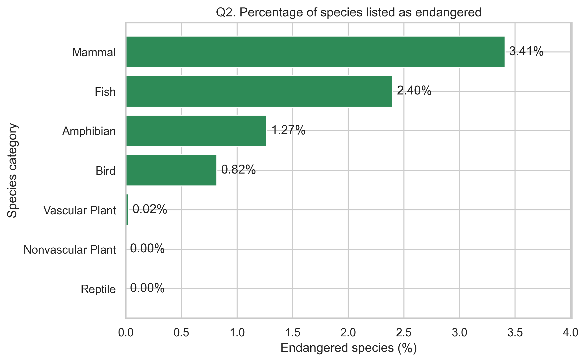
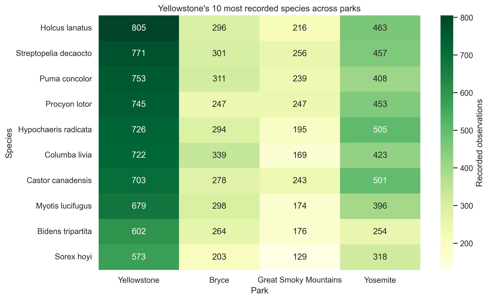

# National Parks Biodiversity Analysis

This project explores species conservation records and observations from four U.S. national parks: Bryce Canyon, Great Smoky Mountains, Yellowstone, and Yosemite. It uses Python to compare conservation statuses across species categories, identify the most recorded species at each park, and visualize how observation counts vary across parks.

The analysis uses a practice dataset. The findings describe the supplied records and their observation counts.

## Research Questions and Findings

| Research question | Key finding |
| --- | --- |
| How are animal species distributed by conservation status? | **86.47%** had no listed status. Among animals with a recorded status, **Species of Concern** was the most common, with **103 species**. |
| Which category had the highest share of species listed as endangered? | **Mammals** ranked highest at **3.41%** (6 of 176), followed by **fish** at **2.40%** (3 of 125). |
| Did the share of species with any listed conservation status differ across categories? | The pairwise chi-square tests found evidence of a difference between **mammals and reptiles** (*p* = 0.0384) and insufficient evidence of a difference between **mammals and birds** (*p* = 0.6876). The overall comparison included a small expected cell count, so its p-value should be interpreted cautiously. |
| Which species had the most recorded observations in each park? | *Columba livia* in Bryce Canyon (**339**), *Streptopelia decaocto* in Great Smoky Mountains (**256**), *Holcus lanatus* in Yellowstone (**805**), and *Hypochaeris radicata* in Yosemite (**505**). |

## Data and Methodology

- `species_info.csv` contains scientific names, common names, species categories, and conservation statuses.
- `observations.csv` contains recorded observation counts by scientific name and park.
- I inspected missing values and duplicate records, joined the tables by scientific name, and created seven category DataFrames for exploring observations with a listed status.
- For conservation percentages, I used the full species table so that species with no listed status remained in the denominator. For park rankings, I aggregated the original observations so that multiple metadata matches could not double-count a record.
- I used chi-square tests to compare whether species had **any listed status**. The endangered percentages measure the share specifically labeled **Endangered**.

## Additional Analysis: Sheep Observations

Yellowstone recorded **507 sheep observations** in one week, compared with **250** in Bryce Canyon, **282** in Yosemite, and **149** in Great Smoky Mountains. At those weekly rates, reaching a target of **870 observations per park** would take **2 full weeks in Yellowstone** and **4 in Bryce Canyon**.

## Visualizations





The heatmap compares Yellowstone’s ten most recorded species across the four parks. The hexbin plot compares species recorded in both Yellowstone and Yosemite. Its densest cluster is around **250 recorded observations in Yellowstone** and **150 in Yosemite**. Darker hexagons contain more species with similar counts, and logarithmic shading makes smaller groups easier to see.

| Figure | Chart |
| --- | --- |
| 1 | [Conservation status of animal species](chart_1.png) |
| 2 | [Conservation status across all species](chart_2.png) |
| 3 | [Percentage of species listed as endangered](chart_3.png) |
| 4 | [Listed conservation status by species category](chart_4.png) |
| 5 | [Most recorded species at each park](chart_5.png) |
| 6 | [Weekly sheep observations by park](chart_6.png) |
| 7 | [Yellowstone's top ten species across parks](chart_7.png) |
| 8 | [Yellowstone and Yosemite observation counts](chart_8.png) |

## Run the Project

From the repository folder, install the dependencies and run the script:

```bash
python -m pip install pandas matplotlib seaborn scipy
python biodiversity_analysis.py
```

The script prints the findings, saves `chart_1.png` through `chart_8.png` in the current folder, and opens the figures.
